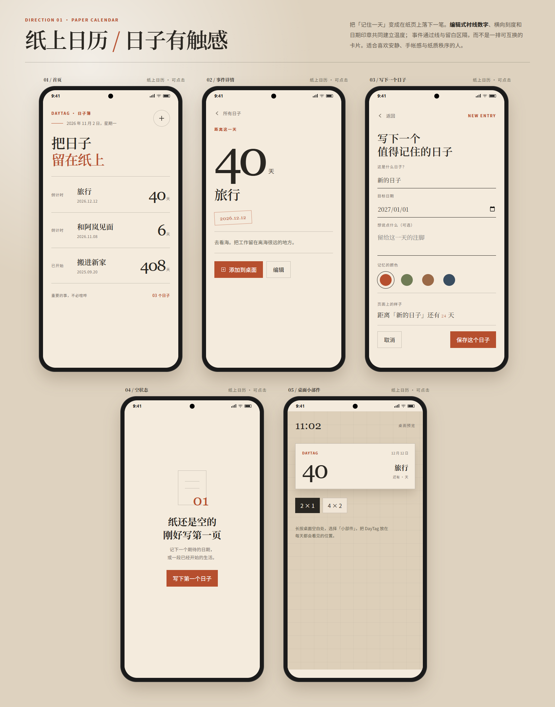
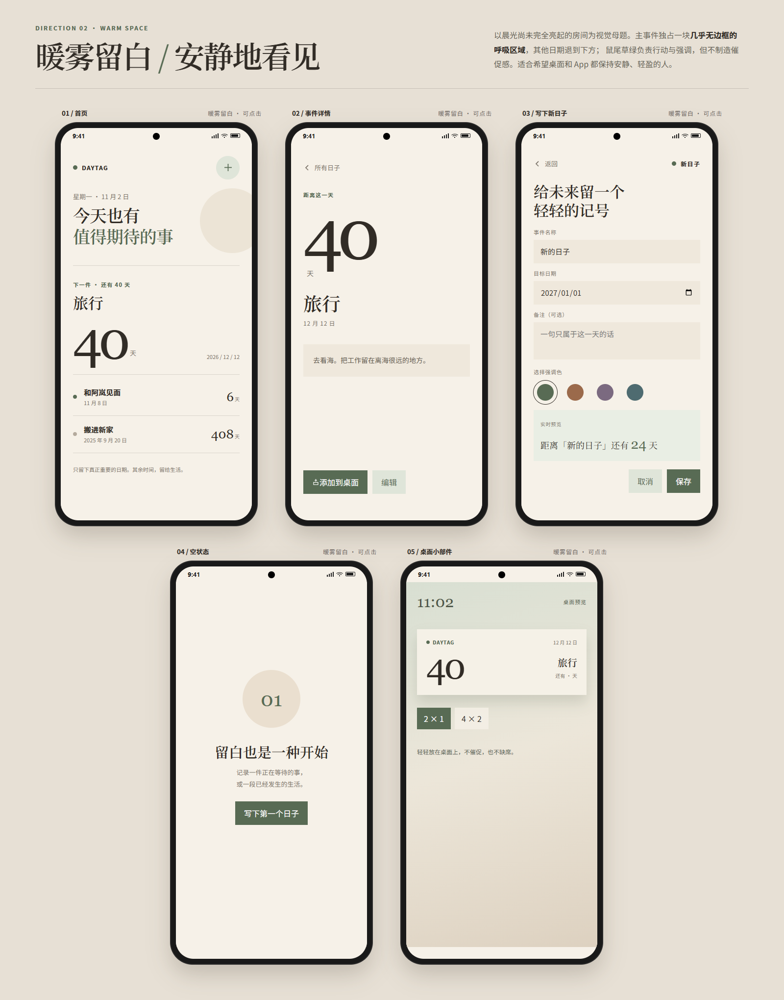
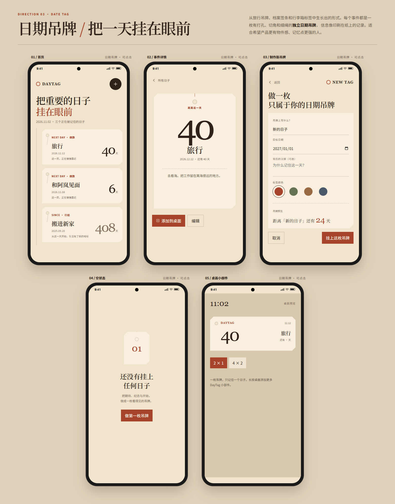

# DayTag

DayTag 是一款本地优先的 Android 倒数 / 正数日应用，计划使用 Kotlin、Jetpack Compose、Room 和 Glance 构建。

当前阶段：三个视觉方向原型已完成，等待选择最终方向后进入 Android 实现。

## 设计原型

- [纸上日历](design-demos/paper-calendar.html)
- [暖雾留白](design-demos/warm-space.html)
- [日期吊牌](design-demos/date-tag.html)

原型可直接双击用浏览器打开。每个页面包含首页、详情、创建 / 编辑、空状态和桌面小部件预览，并支持基础点击交互。

### 方向总览

#### 纸上日历

#### 暖雾留白

#### 日期吊牌

## 产品边界

- 单次目标日期，自动在“还有”和“已经”之间切换
- 每个桌面小部件绑定一个事件
- 本地存储，无账号、无云同步、无网络请求
- 第一版不包含提醒通知和重复日期

