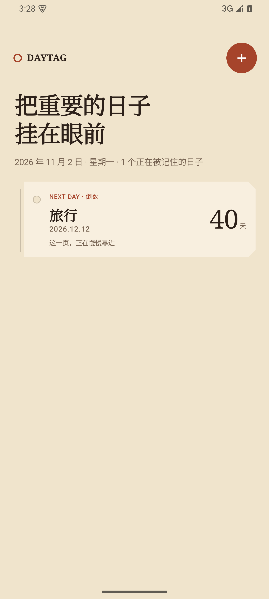
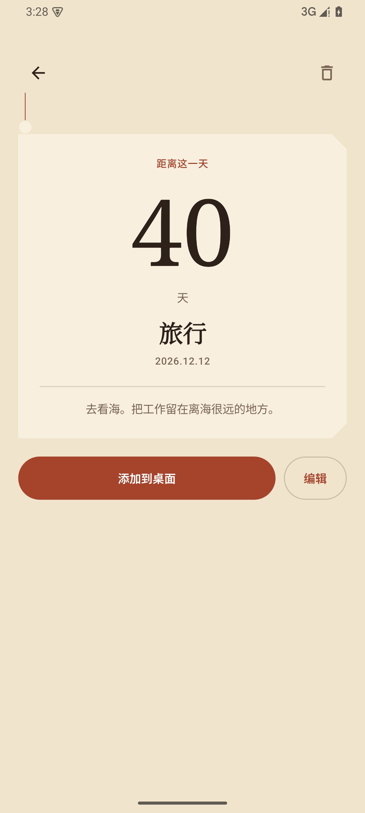
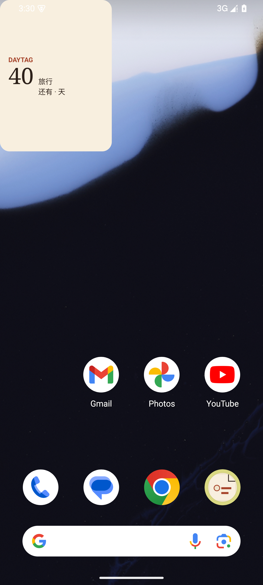

# DayTag

把重要的日子挂在眼前。DayTag 是一款本地优先的 Android 倒数 / 正数日应用，使用 Kotlin、Jetpack Compose、Room 和 Glance 构建。

## 功能

- 创建单次事件，填写标题、目标日期、备注和强调色
- 未来日期显示“还有 N 天”，当天显示“就是今天”，过去后自动切换为“已经 N 天”
- 首页按今天、未来由近到远、过去由近到远排序
- 每个桌面小部件绑定一个事件；同一事件可以添加多个实例
- 小部件支持 `2×1`、`2×2`、`4×2` 三种尺寸
- 点击小部件直接打开对应事件详情
- 事件修改、删除、日期变化、时区变化与设备重启后自动刷新
- 数据只保存在本机，不申请网络权限、通知权限或精确闹钟权限

## 截图

| 首页 | 事件详情 | 桌面小部件 |
| --- | --- | --- |
|  |  |  |

## 安装

可安装的 debug APK 位于：

```text
dist/DayTag-0.1.0-debug.apk
```

通过 ADB 安装：

```powershell
adb install -r .\dist\DayTag-0.1.0-debug.apk
```

也可以先把 APK 传到手机后直接打开安装。首次安装非商店 APK 时，需要在 HyperOS 中允许“安装未知应用”。

## 添加桌面小部件

1. 长按桌面空白处，选择“小部件”。
2. 找到 DayTag，长按预览并拖到桌面。
3. 在配置页选择要展示的事件。
4. 拖动小部件边缘，可调整为 `2×1`、`2×2` 或 `4×2` 比例。

事件详情页也提供“添加到桌面”入口。启动器不支持系统固定接口时，应用会提示改用桌面小部件列表。

## 构建与测试

要求：

- Android Studio / Android SDK（项目使用 compile SDK 37、target SDK 35）
- JDK 17 或更高版本
- Windows PowerShell

```powershell
$env:JAVA_HOME = "C:\Program Files\Microsoft\jdk-17.0.12.7-hotspot"
.\gradlew.bat :app:assembleDebug
```

运行 JVM 单元测试、Lint 和仪器测试：

```powershell
.\gradlew.bat :app:testDebugUnitTest :app:lintDebug
.\gradlew.bat :app:connectedDebugAndroidTest
```

本机验收环境：

- Android 15 / API 35 Google APIs x86_64
- 显示调整为 `1440×3200`，用于接近 Xiaomi 15 Ultra 的 WQHD+ 分辨率
- 单元测试、Lint、APK 构建和 2 个仪器测试全部通过

## 设计

最终方向为「日期吊牌」：奶油纸色、深可可文字、朱砂强调色，以及打孔、切角和票根式信息结构。方向确认记录在 [design/direction-approved.md](design/direction-approved.md)，三方向原型仍保留在 [design-demos](design-demos)。

## 当前边界

- 简体中文界面
- 日期不含具体时间
- 不支持每年、每月或每周重复事件
- 不做提醒通知
- 不做账号、云同步或跨设备同步
- 尚未在 HyperOS 真机上验证小米桌面的厂商差异
